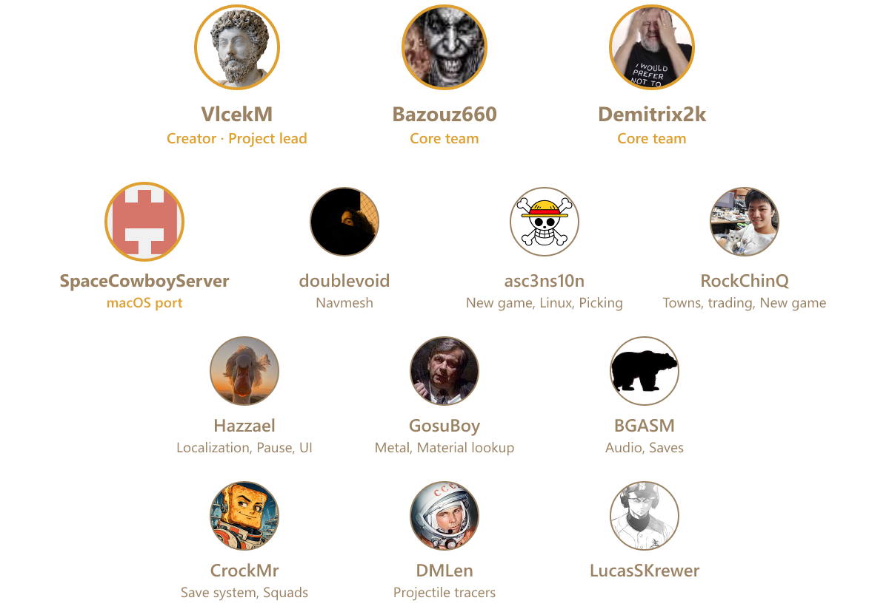

<p align="center">
  
</p>

[](https://ko-fi.com/martinvlcek)

C#/.NET10 reimplementation of [Kenshi](https://lofigames.com/), aiming to run original content,
mods and saves unchanged. **No game assets are shipped; an installed legal copy is required.**
Architecture/research: [docs index](docs/README.md). Website: [meitou.kenshi.wiki](https://meitou.kenshi.wiki/).

[](https://github.com/VlcekM/MeitouClient/graphs/contributors)


## Download and requirements

The easiest way to get the game is the [Meitou Launcher](https://github.com/VlcekM/MeitouClient/releases/latest): it installs and
updates the game and manages mods. Download the newest one for

[Windows](https://github.com/VlcekM/MeitouClient/releases/latest/download/MeitouLauncher-win-x64-Setup.exe) (Setup.exe),

[Linux](https://github.com/VlcekM/MeitouClient/releases/latest/download/MeitouLauncher-linux-x64.AppImage) (AppImage),

[macOS Apple silicon](https://github.com/VlcekM/MeitouClient/releases/latest/download/MeitouLauncher-osx-arm64-Setup.pkg) or

[macOS Intel](https://github.com/VlcekM/MeitouClient/releases/latest/download/MeitouLauncher-osx-x64-Setup.pkg) (unsigned, Gatekeeper warns).

By hand: [releases](https://github.com/VlcekM/MeitouClient/releases) for Windows, Linux and macOS, unzip and run

Steam installs, and GOG installs made by GOG Galaxy, Heroic, Lutris or Bottles, are located automatically; otherwise select the Kenshi folder when prompted,
set KENSHI_PATH, or create git-ignored meitou.local.json in the repo/working/executable directory (on Linux and macOS also `~/.config/meitou/config.json`, the place the prompt saves to when the executable's folder is read-only):

```json
{ "kenshiPath": "<your Kenshi install directory>" }
```

## Build and run

Building requires the [.NET10 SDK](https://dotnet.microsoft.com/download).

```text
dotnet build -c Release
dotnet test -c Release --filter "Category!=Slow&Category!=Bench"
dotnet run -c Release --project src/Meitou.Game
```

Run the full suite before committing. Slow tests require assets/GPU/long runs; Bench tests assert
timing and need a quiet machine. Game/viewer share the rendering and data libraries. Use
--help / viewer --world --help for options. Tab opens settings, F10 lists current keys, F11/F12
show statistics/profiler. Game F5 saves/F9 loads; F2..F4 select1/2/5 speed, Space pauses,
F6 cinematic camera, F7 hides UI. [Viewer guide](docs/viewer.md), [simulation](docs/simulation.md),
[UI compatibility](docs/faithful-ui-parity.md).

## Releases and license

GPL-3.0-or-later, with [license exception](LICENSE-EXCEPTION.md). Readers and game logic use
interoperability facts; proprietary SDKs/original content/decompiled code are not distributed.
Contribution rules: [AGENTS.md](AGENTS.md); current choices: [DECISIONS.md](DECISIONS.md).
